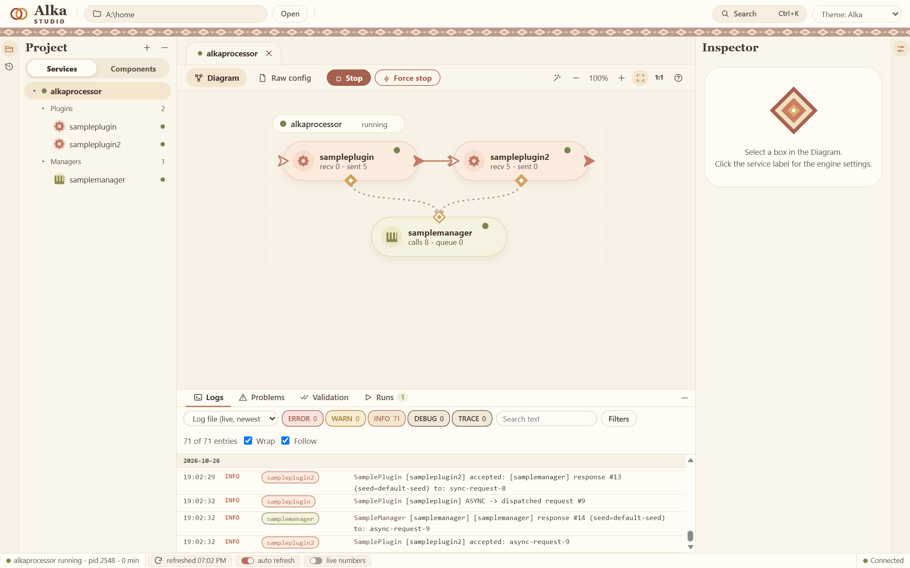

# Alka

Web page: https://alkadev.com

Alka is a small service engine for Java. You write the pieces of a service as **plugins** and **managers** (one jar each), and the engine loads them and runs them from configuration files. **Alka Studio**, a tool in your browser, shows how the pieces are wired, edits their settings, starts and stops the service and shows its log.



```
 plugin ──sends events──▶ plugin          a plugin does the work and talks to other plugins
   │
   └──asks──▶ manager                     a manager owns what plugins share: a connection, a cache, a device
```

**State:** version 0.x, the first public versions. The API can still change before 1.0.0. It was tried on Windows only; Linux and macOS are expected to work but are not tried yet.

## Download and run the demo

1. You need **Java 21 or newer** (`java -version`), for example from https://adoptium.net.
2. Download `alka-<version>.zip` from the [latest release](https://github.com/LejlaO/alka/releases/latest) and unzip it anywhere.
3. Start `studio.bat` (Windows) or `./studio.sh` (Linux, macOS). The Studio opens in your browser.
4. Select the service **alkaprocessor** (the demo), press **Start**, and watch the log: one plugin greets a manager every few seconds, and a second plugin receives what the first sends on.

### What is on the release page

| File | What it is | Do you need it? |
|---|---|---|
| `alka-<version>.zip` | **The package.** The Studio, the engine, a `home` folder with the demo service, `studio.bat` and `studio.sh`, the licenses. | **Yes, this one.** Unzip it and start the Studio. |
| `alka-<version>-home.zip` | Only the `home` folder (the engine, the config, the demo), without the Studio. | Only if you already have a Studio and want a second home to run services in. |
| `SHA256SUMS.txt` | The checksums of the two zips. | No. It lets you check that a download is whole and is the file that was released (below). |
| Source code (zip, tar.gz) | Added by GitHub: the source of this public repository at that version (the API, the Maven plugin, the project generator). | No. Not needed to run Alka. |

The libraries (the API, the parent pom, the Maven plugin, the project generator) are not on the release page. They are on [Maven Central](https://central.sonatype.com/namespace/com.alkadev) as `com.alkadev:*` and Maven fetches them by itself when you build a plugin.

To check a download, compare its checksum with the line in `SHA256SUMS.txt`: on Windows `Get-FileHash alka-<version>.zip -Algorithm SHA256` in PowerShell, on Linux and macOS `sha256sum alka-<version>.zip`.

## Make your own plugin or manager

You need Java 21 and [Maven](https://maven.apache.org) 3.9 or newer. One command makes a small project:

```
mvn archetype:generate -DarchetypeGroupId=com.alkadev -DarchetypeArtifactId=alka-sample-archetype -DarchetypeVersion=0.2.0
```

Maven asks for a group id, an artifact id (say `myalka`), a version and a package, and makes three modules: a manager, a plugin that talks to it, and a service that wires the two. Then:

```
cd myalka
mvn install
mvn package alka:deploy -Dalka.home=<the folder "home" of the unzipped package>
```

Open the Studio again: the service `myalka` is in the list, and its manager and plugin are in the Components palette. Start it and watch the log. The guide [Your first plugin](docs/your-first-plugin.md) goes through it step by step.

## Read more

- [How Alka works](docs/how-it-works.md): services, plugins, managers, wiring, events, settings, the folders of a home. One page, read it before the code.
- [Your first plugin](docs/your-first-plugin.md): from the generated project to a plugin of your own.
- [Things to know](docs/gotchas.md): the places where a plugin surprises its author (threads, settings, shared state).
- [Releasing](RELEASING.md): how a release of this repository is made.

## What is in this repository

| Module | Group id | What it is |
|---|---|---|
| `annotations` (`alka-annotations`) | `com.alkadev` | `@AlkaSettings` and the annotation processor that writes the settings template of a jar |
| `utils/common` (`alka-common`) | `com.alkadev.utils` | the base of every component (`AlkaComponent`), the loader of plugin and manager jars |
| `utils/objectmanager` (`alka-objectmanager`) | `com.alkadev.utils` | the base class of a manager (`ObjectManager`) |
| `utils/objectplugin` (`alka-objectplugin`) | `com.alkadev.utils` | the base class of a plugin (`ObjectPlugin`) |
| `plugin-parent` | `com.alkadev` | `alka-plugin-parent`: the parent pom of a plugin or a manager |
| `maven-plugin` | `com.alkadev` | `alka-maven-plugin`: the goals `alka:package` and `alka:deploy` |
| `archetype` | `com.alkadev` | `alka-sample-archetype`: makes a small project with a manager, a plugin and a service |
| `samples/sampleplugin` | `com.alkadev` | a reference plugin with every kind of setting |
| `samples/samplemanager` | `com.alkadev` | a reference manager |

The engine and Alka Studio are not in this repository: they are given as binaries in the package.

To build this repository yourself you need Java 21 and Maven: `mvn install`.

## License

- **This repository** (the API, the Maven parent and plugin, the archetype and the samples): [Apache License 2.0](LICENSE).
- **The package** (the engine and Alka Studio, as binaries): free for **noncommercial** use under the PolyForm Noncommercial License 1.0.0 with a few added terms; commercial use needs written permission, which you can ask for by [opening an issue](https://github.com/LejlaO/alka/issues). The text is `LICENSE-binaries.txt` in the package. The libraries of Apache Log4j that come with it are under the Apache License 2.0.

Copyright 2026 Lejla Omerovic.
